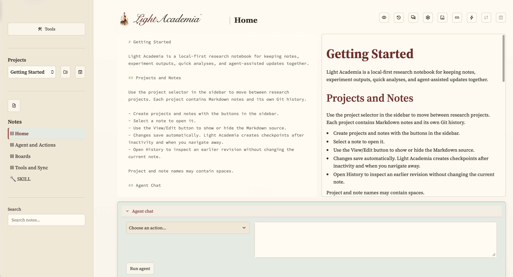

# Light Academia

Local-first research notes with an agent-assisted project workspace.



*A research note shown in the split editor and preview workspace.*

## Vibe coding disclaimer

This project was developed with substantial AI assistance and prioritizes functionality over software engineering rigor. The code may contain
errors, insecure assumptions, or unexpected behavior. Review and test it
carefully before using it with important data or in a production environment.


## Security and safety disclaimer
This tool is expected to be run locally in environments with no access to highly sensitive data. While it uses Web technologies for maximum portability, it should never be exposed over the Internet.

It is the user's responsibility to ensure that their agent set-up is adequately sandboxed. The developers of the tool are not responsible for any unwanted or undesirable behaviour of the tool or of the AI agent.


## Desktop application

Install from this checkout and start the native desktop window:

```bash
python -m pip install -e .
lightacademia
```

You can also run `python -m lightacademia` after installing `requirements.txt`.
The existing `./lightacademia.sh` launcher also opens the desktop window and
uses this checkout's `notebook/` and `tools/` folders.
The editable install keeps the CLI connected to this checkout, which contains
its Streamlit entry point, themes, prompts, and starter notebook.

The window is named **Light Academia** and uses `assets/logo.png` as its native
application icon. The launcher starts a localhost-only Streamlit server on an
automatically selected port and stops it when the window closes. Server output
stays in the terminal; `--debug` enables webview developer tools.

```bash
lightacademia --notebook ./my-notebook --tools ./my-tools --agent claude
lightacademia --agent codex --codex-model gpt-5-codex
lightacademia --help
```

Desktop launches default to `~/Light Academia/notebook` and
`~/Light Academia/tools`, so data stays outside the application bundle. To use
an existing checkout notebook, pass `--notebook ./notebook --tools ./tools`.
Relative paths are resolved from the directory where you invoke the CLI.
The existing `--autocommit-seconds` and `--agent-timeout-seconds` options are
also supported.

To build a standalone application, run this on the target operating system:

```bash
python -m pip install -r requirements.txt pyinstaller pillow
# Optional: install requirements-codex.txt before building for Codex support.
python -m PyInstaller --clean --noconfirm 'Light Academia.spec'
```

On macOS, open `dist/Light Academia.app`. Its bundle name, Dock identity, and
icon are Light Academia's, rather than Python's. On Windows and Linux, the
application is in `dist/Light Academia/`. Builds are platform-specific. Linux
requires a supported GTK or Qt webview backend; Windows requires WebView2.
See the [pywebview installation guide](https://pywebview.flowrl.com/guide/installation.html)
for native dependencies. The bundle still uses your installed agent tools and
credentials. Notebook scripts use an installed Python interpreter; set
`LIGHTACADEMIA_PYTHON` to its absolute path to select a virtual environment
with your research dependencies. Signing and notarization are separate distribution steps.

## Run in a browser

```bash
python -m pip install -r requirements.txt
python -m streamlit run app.py
```

Use a custom notebook folder:

```bash
python -m streamlit run app.py -- --notebook ./my-notebook
```

On first launch, Light Academia copies the stock projects from
`starter-notebook/` into the configured notebook folder and creates a `.ready`
marker there. Existing projects are preserved. Later launches skip this setup
while the marker exists.

Use a custom automatic commit inactivity period:

```bash
python -m streamlit run app.py -- --autocommit-seconds 600
```

Use a custom researcher tools folder:

```bash
python -m streamlit run app.py -- --tools ./my-tools
```

The tools folder can contain `SKILL.md` describing available researcher-specific commands, such as cluster, cloud, or wandb helpers.

Each project can also contain its own `SKILL.md` for project-specific guidance on how to use those tools.

## Daily Notes

Use **Today** in the sidebar to create or open today's daily note. Each note
is titled with its ISO date (`YYYY-MM-DD`); repeated clicks reopen the same note
and preserve its contents. Dates use the local timezone of the app server.

Daily notes live in the hidden `.daily-notes/` workspace inside the configured
notebook folder, separate from regular projects. They use the normal note editor,
history, and automatic checkpoints. Search includes daily notes alongside the
current project's notes; within Daily Notes, search covers all daily entries.

The robot in Daily Notes can read and update any project under the configured
notebook folder without switching projects. Its default output remains the
selected daily note. Robots in regular projects remain scoped to their project.

The **Calendar** button opens a monthly calendar. Days with notes are marked
with a dot and can be clicked to open that day's note. Use Previous and Next
to browse months.

## Note actions

The active note can define reusable agent actions. Actions are parsed locally with
`markdown-it-py` and appear in the selector beside the agent prompt.

````markdown
```action
name: Compare validation accuracy

Retrieve the relevant results.
Plot the comparison.
Add the results to this note.
```
````

The action body can be run by itself or combined with an additional prompt.
In the preview, a bolt button above each action block selects that action in the
pinned agent controls without running it immediately.

## Boards

Boards are note-local, agent-refreshed dataframes. A board defines how to fetch
its rows and may expose actions for each row:

````markdown
```board
name: Experiments
fetch: fast
actions:
- [fast,refresh] Resume: Resume the selected experiment
- Troubleshoot: Tail the log file and summarize the findings
filters:
- Name
- Cluster: dropdown
- Status: dropdown
columns:
- Name
- Cluster
- Status
- Epoch

Fetch experiments from the cluster that have run within the last week.
```
````

With `fetch: fast`, the first refresh asks the Robot to create
`code/board-experiments-fetch.py` and write `data/board-experiments.csv`.
Later refreshes run that script directly. Changing any part of the board
invalidates its reusable scripts, and Light Academia asks the Robot to reconcile
them before using them again. Omit `fetch: fast` to run the Robot on every
refresh.

When the CSV exists, the preview displays it as an interactive dataframe.
Refreshing never executes the board's row actions. Each declared action becomes
a button column. Robot refreshes and row actions use the normal stoppable
progress display.

Prefix an action with `[fast]` to have the Robot create a reusable script such
as `code/board-experiments-action-resume.py`. Its first run creates the script
and performs the action. Later runs pass the selected row to that script and do
not invoke the Robot. Actions without `[fast]` retain the normal Robot workflow.

Add `refresh` to an action's flags, for example `[fast,refresh]`, to refresh the
board after a successful action. A current fast fetch script runs directly; all
other boards use the normal Robot refresh flow.

Board filters are local and do not call the Robot. A bare column name creates a
case-insensitive text filter. Add `: dropdown` to select from the distinct values
in that CSV column. The currently supported types are `text` and `dropdown`.

The optional `columns` list defines the required CSV schema and display order.
Light Academia includes it in the Robot's refresh instructions and warns when
the generated CSV is missing a requested column.

## Project images

Generated images belong in the selected project's `assets/` directory and can be
embedded in notes with project-relative Markdown:

```markdown

```

The preview resolves supported local image links only within that project's
`assets/` directory.

## Agent

The app uses an agent abstraction in `lightacademia/agents.py`.

The agent instructions are stored in `AGENT_PROMPT.md`. Review this file before
using the app and adjust its rules for your environment and risk tolerance. Keep
the `{{project_name}}`, `{{project_dir}}`, `{{tools_dir}}`, `{{tools_root}}`,
`{{current_note}}`, and `{{user_prompt}}` placeholders where their runtime values
should be inserted.

Select the agent implementation at startup:

```bash
python -m streamlit run app.py -- --agent codex
python -m streamlit run app.py -- --agent claude
```

Codex support is optional. Install the Codex-enabled dependency set before
starting the app with `--agent codex`:

```bash
pip install -r requirements-codex.txt
```

When using Codex, the default model is `gpt-reserve`. Select a different startup
default with `--codex-model`. Choices made in the Model picker stick for the current
session only; new sessions start with the configured default:

```bash
python -m streamlit run app.py -- --agent codex --codex-model gpt-5-codex
```

The default implementation uses the official Codex Python SDK:

- Uses `openai-codex`, including its pinned local Codex app-server runtime
- Streams typed SDK notifications into the pinned agent section
- Displays Codex events directly without a separate summarization model call
- Uses the selected project as the working root
- Adds a temporary copy of the configured tools folder as an auxiliary workspace
- Sets `LIGHTACADEMIA_TOOLS` to the available tools root. Project scripts should
  resolve this variable at runtime rather than embedding the temporary path.
- Uses `workspace-write` sandboxing
- Enables outbound network access for commands inside the Codex workspace-write sandbox
- Tells Codex to write derived outputs under `data/` and scratch scripts under `code/`
- Tells Codex to read project-level `SKILL.md` when present
- Tells Codex to read and run tools from the configured tools folder
- Prevents Codex from editing the configured tools folder by exposing only a temporary copy
- Tells Codex not to access folders outside the selected project and tools folder
- Tells Codex not to download or install software from the Internet
- Tells Codex to interact with compute clusters only through configured tools
- Tells Codex not to run git commands
- Leaves git checkpoints and commits to the application
- Uses `[agent]`-prefixed commit messages for commits created after agent actions

Claude Code CLI support is also available with `--agent claude`:

- Runs `claude --print --output-format stream-json --verbose`
- Uses the selected project as the working root
- Adds a temporary copy of the configured tools folder with `--add-dir`
- Uses `acceptEdits` permission mode and allows common file/shell tools
- Streams Claude JSON events into the same pinned agent progress section
